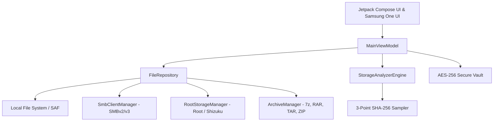

# NovaFiles 🚀

[-3DDC84?style=for-the-badge&logo=android&logoColor=white)](https://developer.android.com)
[](https://kotlinlang.org)
[](https://developer.android.com/jetpack/compose)
[](https://www.samsung.com/one-ui/)
[](releases/NovaFiles-v1.0.0-beta2-signed.apk)
[](LICENSE)

**NovaFiles** is an advanced, ultra-responsive next-generation Android file manager designed and developed by **Abhinav Kishore (XanDron45)**. Built with **Jetpack Compose**, **Material Design 3**, and dedicated **Samsung One UI** design system elements, NovaFiles combines desktop-class file management with zero-knowledge cryptographic privacy and enterprise LAN networking.

---

## ✨ Key Features

### 🗂️ Desktop-Class File Management & Dual-Pane Browsing
- **Dual-Pane File Browser**: Multitask across dual panels or tabbed panes for rapid cross-directory file copying, moving, and comparison.
- **Deep File Operations**: Batch copy, move, rename, delete, recursive search, hidden file toggles, and metadata inspection.
- **APK Manager**: Inspect installed user and system applications, extract base APKs, and analyze package signatures and permissions.

### 🎨 Samsung One UI Adaptive Icon Pack & Theming
- **Adaptive Vector Icon Set**: Pixel-crafted squircle icons designed to blend seamlessly into Samsung One UI 6 & 7 and modern AOSP launchers.
- **Monochrome & Cobalt Variants**: Includes high-contrast Cobalt squircle backgrounds, dynamic material accenting, and themed monochrome icons for Android 13+.
- **One UI Design Mode**: Native One UI squircle card corners (26.dp), tactile feedback, and oversized header viewing areas for effortless one-handed ergonomics.

### 🔒 AES-256 Encrypted Private Vault
- **Zero-Knowledge Architecture**: Secure local private vault protected with salted PBKDF2/SHA-256 PIN authentication.
- **Cryptographic Obfuscation**: Files moved to the vault are encrypted on-the-fly using `AES/CBC/PKCS5Padding` with uniquely generated Initialization Vectors (IVs) per file.
- **Stealth Protection**: Encrypted vaults remain invisible to standard Android media scanners and third-party applications.
- **Cryptographic File Shredder**: Multi-pass random byte overwrite and zero-fill for permanent unrecoverable deletion.

### 🗜️ Comprehensive Universal Archive Suite
- **Complete Format Support**: Read, browse, inspect, and extract:
  - **ZIP** archives (standard Deflate, Store)
  - **7-Zip (`.7z`)** archives powered by Apache Commons Compress
  - **WinRAR (`.rar`)** archives powered by Junrar (RAR4/RAR5 format headers)
  - **TAR & GZ (`.tar`, `.tar.gz`, `.tgz`)** UNIX archives
- **In-Archive Browsing**: Explore nested compressed folder hierarchies and inspect file sizes, CRC checksums, and compression ratios prior to decompression.

### 🌐 SMBv2 & SMBv3 True Windows Share Client & Wi-Fi FTP
- **Native Protocol Stack**: Direct SMBv2/SMBv3 implementation via `smbj` for modern Windows 10/11 and Linux Samba network shares.
- **LAN Discovery & Remote Browser**: Connect with NTLMv2 credentials, traverse remote shares, and download files directly over Wi-Fi.
- **Embedded Wi-Fi FTP Server**: Cable-free local file server on port 2121 with anonymous mode and live connection logging.

### ⚡ Shizuku & Root Privileged File Explorer
- **Privileged Shell Operations**: Elevated shell command execution (`su`) for rooted devices to inspect restricted partitions (`/`, `/system`, `/data`, `/vendor`).
- **Interactive Shell Console**: Execute custom shell commands with real-time green-on-black terminal output.
- **Shizuku Integration**: Binder status detection and privileged API access for non-root ADB-level system file exploration.

### 🧠 Intelligent Storage Analyzer & Safe Duplicate Detection
- **Visual Storage Breakdown**: Interactive disk usage breakdown categorizing Images, Videos, Audio, Documents, Archives, and Apps.
- **3-Point SHA-256 Duplicate Scanner**: Eliminates false positives by computing multi-point cryptographic samples (64KB Head + 64KB Mid + 64KB Tail) rather than simple file sizes or truncated prefixes.
- **Large & Redundant File Cleanup**: Instantly locate dormant APKs, abandoned cache folders, and bloated media.

---

## 🏗️ Architecture & Technology Stack



| Layer | Component | Technologies |
|---|---|---|
| **UI & UX** | Screens, Components, Dialogs | Jetpack Compose 1.7+, Material Design 3, Samsung One UI theme system |
| **Language** | Modern Kotlin | Kotlin 2.0.0, Coroutines, StateFlow, Flow |
| **Networking** | SMB Client & FTP Server | `com.hierynomus:smbj:0.13.0` (SMB2/SMB3), raw socket FTP server |
| **Privilege** | Root / Shizuku | Rikka Shizuku API 13.1.5, Superuser Shell (`su`) |
| **Compression**| Universal Archives | Apache Commons Compress 1.26.1, Junrar 7.5.5, `java.util.zip` |
| **Storage & DB** | Persistence & Settings | Android Room 2.7.0, DataStore Preferences |
| **Security** | Vault Encryption & Signing | `javax.crypto.Cipher` (AES/CBC/PKCS5Padding), SHA-256, APK v2 signing |

---

## 📦 Beta Releases

### 🌟 Latest Release: `v1.0.0-beta2` (Signed Release & Debug)

| Variant | Download File | Size | SHA-256 Checksum |
|---|---|---|---|
| **Signed Release APK** | [`releases/NovaFiles-v1.0.0-beta2-signed.apk`](releases/NovaFiles-v1.0.0-beta2-signed.apk) | 22.9 MB | `95D5707DE1D3389F5051E88B3FDD3CEC2E4BE63FD125F4836EB38352A08EF129` |
| **Debug APK** | [`releases/NovaFiles-v1.0.0-beta2-debug.apk`](releases/NovaFiles-v1.0.0-beta2-debug.apk) | 29.8 MB | `BD06301EF3777BB5F8982F19EB5FC4A2794419780B49DED05C84D29C3FA6F21D` |

- **Version**: `1.0.0-beta2` (versionCode `2`)
- **Package ID**: `com.aistudio.novafiles.kxmfle`
- **Signing**: APK Signature Scheme v2 (Production RSA 2048-bit key)

### Verification
You can verify the release integrity on Windows PowerShell:
```powershell
Get-FileHash releases/NovaFiles-v1.0.0-beta2-signed.apk -Algorithm SHA256
```
Or on Linux / macOS:
```bash
sha256sum releases/NovaFiles-v1.0.0-beta2-signed.apk
```

---

## 🛠️ Building from Source

### Prerequisites
1. **Java Development Kit**: JDK 17, 21, or 25 (e.g. Android Studio JBR).
2. **Android SDK**: Target SDK 36 (Android 16 preview) or SDK 34/35.
3. **Gradle**: 8.11+ / 9.x (wrapper included).

### Build Steps

1. **Clone the repository**:
   ```bash
   git clone https://github.com/xan45/NovaFiles.git
   cd NovaFiles
   ```

2. **Configure Local SDK**:
   Create a `local.properties` file in the project root:
   ```properties
   sdk.dir=C\:\\Users\\<YourUsername>\\AppData\\Local\\Android\\Sdk
   ```

3. **Assemble Signed Release APK**:
   ```bash
   ./gradlew assembleRelease
   ```
   The compiled APK will be generated at:
   `app/build/outputs/apk/release/app-release.apk`

4. **Assemble Debug APK**:
   ```bash
   ./gradlew assembleDebug
   ```

---

## 👨‍💻 Project Lead & Attributions

- **Primary Developer & Project Lead**: **Abhinav Kishore (XanDron45)**
- **Open-Source Attributions**:
  - Google Jetpack Compose & Material Design 3 (Apache 2.0)
  - Apache Commons Compress 1.26.1 (Apache 2.0)
  - Junrar 7.5.5 (UnRar License)
  - SMBJ 0.13.0 (Apache 2.0)
  - Rikka Shizuku API 13.1.5 (Apache 2.0)
  - Coil Image Loader (Apache 2.0)
  - AndroidX Room, DataStore, & Lifecycle (Apache 2.0)

---

## 📄 License

NovaFiles is licensed under the **Apache License 2.0**. See the [LICENSE](LICENSE) file for more information.
